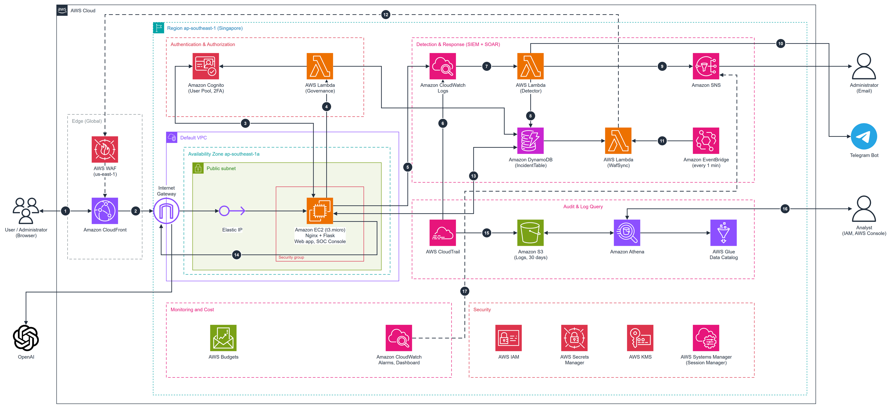

# LogSentinel — Proposal

## Giới thiệu

Dự án của em là **LogSentinel**: hệ thống giám sát log tập trung (SIEM) và phản ứng tự động (SOAR) trên AWS, dành cho doanh nghiệp nhỏ và vừa không có đội vận hành bảo mật (SOC) riêng. Hệ thống đọc log của web app và log hoạt động tài khoản AWS, phát hiện tấn công, tự khóa IP kẻ tấn công và báo cho quản trị viên qua email, Telegram và một trang quản trị web (SOC Console).

## Bài toán

Doanh nghiệp nhỏ thường chỉ biết mình bị tấn công khi đã có thiệt hại. Log có sẵn nhưng là văn bản thô, không ai đọc hằng ngày. Các dịch vụ chuyên dụng như GuardDuty hay Security Hub thì mạnh, nhưng khó cấu hình và tốn chi phí đối với công ty nhỏ. Trong khi đó, những tấn công phổ biến nhất như đoán mật khẩu, SQL injection, dò quét đường dẫn, đăng nhập root hay leo thang quyền IAM đều để lại dấu vết rất rõ trong log.

LogSentinel giải bài toán này bằng **20 luật phát hiện** (7 luật cho log web app, 13 luật cho CloudTrail) và **6 cảnh báo quản trị**. Hệ thống tự khóa IP trong 24 giờ ở cả ba lớp: ngay trong web app, ở Detector và ở AWS WAF. Mỗi cảnh báo được viết bằng tiếng Việt dễ đọc, gửi tới điện thoại chỉ vài giây sau khi sự việc xảy ra.

Em dùng AI (OpenAI) làm **trợ lý giải thích sự cố** trong SOC Console. AI chỉ đọc: nó không tự gỡ khóa IP, không đổi quyền, không thay đổi gì trong hệ thống. Khi cần thao tác, AI chỉ hướng dẫn người dùng tự bấm nút. Việc phát hiện và khóa IP hoàn toàn do luật cố định đảm nhận, không phụ thuộc vào AI.

## Workflow

Các số dưới đây khớp với số trên sơ đồ.

1. **Truy cập:** người dùng và quản trị viên vào web qua Amazon CloudFront (HTTPS). AWS WAF gắn với CloudFront. WAF chặn các IP trong danh sách khóa và giới hạn tốc độ theo IP (riêng các đường dẫn đăng nhập tối đa 100 request mỗi 5 phút), trước khi request tới máy chủ.
2. **Vào máy chủ:** CloudFront chuyển request qua Internet Gateway và Elastic IP tới EC2, nằm trong public subnet của default VPC (AZ `ap-southeast-1a`). Security group chỉ nhận request từ CloudFront (managed prefix list), kèm một header bí mật để chặn người gọi thẳng vào IP. Trên EC2, Nginx đứng trước ứng dụng Flask (web mẫu và SOC Console).
3. **Đăng nhập:** tài khoản do Amazon Cognito quản lý: tự đăng ký, xác nhận email, thanh đo độ mạnh mật khẩu, quên mật khẩu, 2FA TOTP. Có ba vai trò: Chờ duyệt, Người xem và Quản trị. Quản trị bắt buộc phải bật 2FA.
4. **Phân quyền:** mọi thay đổi vai trò chạy trong Lambda Governance. EC2 không có quyền ghi vào Cognito. Quản trị viên phải mở mục Phân quyền bằng PIN riêng. Muốn nâng hay hạ quyền Quản trị cần đa số admin bỏ phiếu, vô hiệu hóa tài khoản cần 2 người duyệt, và hệ thống luôn giữ tối thiểu 2 admin. Phiếu bầu lưu trong DynamoDB.
5. **Thu thập log ứng dụng:** CloudWatch Agent đẩy log của web app (đăng nhập sai, SQL injection, 404, sai mã OTP...) lên CloudWatch Logs.
6. **Thu thập log tài khoản AWS:** CloudTrail ghi mọi hoạt động quản trị (đa region, mã hóa KMS, có kiểm tra toàn vẹn file) và đẩy về CloudWatch Logs.
7. **Phát hiện:** subscription filter chuyển log tới Lambda Detector ngay khi log về. Detector chạy 20 luật, ví dụ: một IP sai mật khẩu 5 lần trong 60 giây, đăng nhập root, tắt CloudTrail, gắn quyền `AdministratorAccess`.
8. **Ghi sự cố và khóa IP:** Detector ghi sự cố vào DynamoDB (mã hóa KMS, tự xóa sau 30 ngày). Với tấn công vào web, Detector ghi thêm `BLOCKED_IP#<ip>` để khóa IP 24 giờ. IP của quản trị viên (`admin_cidr`) không bao giờ bị khóa.
9. **Cảnh báo email:** Detector gửi cảnh báo qua Amazon SNS tới email quản trị viên.
10. **Cảnh báo Telegram:** Detector gửi tin HTML gọn cho điện thoại qua Telegram Bot API. Mọi giá trị do kẻ tấn công nhập đều được escape, và cùng một vụ chỉ báo một lần.
11. **Đồng bộ danh sách chặn:** EventBridge kích hoạt Lambda WafSync mỗi phút. WafSync đọc danh sách IP đang bị khóa trong DynamoDB.
12. **Chặn ở biên:** WafSync cập nhật IP set của AWS WAF (us-east-1), nên IP bị khóa bị chặn ngay tại CloudFront, không còn tới được máy chủ.
13. **SOC Console:** web app đọc và ghi DynamoDB. Phần ghi gồm: gỡ khóa IP, thu hồi phiên, đếm lượt hỏi AI. Phần đọc dùng để hiển thị sự cố, thống kê 24 giờ / 7 ngày / 30 ngày, danh sách IP bị khóa (quản trị viên có nút gỡ khóa), và trả 403 cho IP đang bị khóa. Console tự làm mới mỗi 15 giây.
14. **Trợ lý AI:** người dùng bấm "Hỏi AI" cạnh một sự cố. Backend gửi câu hỏi kèm tối đa 10 sự cố liên quan sang OpenAI, đi ra Internet qua Internet Gateway (security group chỉ cho kết nối ra cổng 443). Email được che, chuỗi dài bị cắt, dữ liệu log được rào lại để chặn prompt injection nằm trong log. Mỗi người tối đa 30 câu mỗi ngày, và OpenAI không lưu hội thoại (`store=False`).
15. **Lưu trữ:** CloudTrail ghi bản gốc vào S3, có vòng đời 30 ngày.
16. **Điều tra:** người phân tích dùng Athena truy vấn SQL. Athena đọc thẳng log CloudTrail trên S3 và ghi kết quả vào thư mục `athena-results/` của cùng bucket. Glue Data Catalog chỉ giữ định nghĩa bảng (schema). Mỗi truy vấn bị giới hạn ở 1 GB dữ liệu quét, và hệ thống có sẵn 5 truy vấn mẫu với quyền chỉ đọc.
17. **Giám sát chính hệ thống:** CloudWatch Alarms gửi email qua SNS khi Detector lỗi, khi có sự cố CRITICAL trên web, khi CloudTrail bị can thiệp, hoặc khi WafSync lỗi. AWS Budgets gửi email khi chi phí thực tế đạt 80% hoặc dự báo vượt 100% ngân sách.

## Giám sát và bảo mật

Ngoài các luồng trên, em dùng các dịch vụ sau để giám sát và bảo mật:

- **IAM theo nguyên tắc least privilege:** mỗi Lambda và EC2 có role riêng, chỉ được làm đúng việc của mình.
- **Secrets Manager:** giữ token Telegram, OpenAI API key và header bí mật của CloudFront.
- **KMS:** mã hóa bảng sự cố và log CloudTrail.
- **Systems Manager Session Manager:** quản trị máy chủ mà không mở cổng 22.
- **CloudWatch, CloudTrail, WAF và Budgets:** giám sát hệ thống và chi phí.

Máy EC2 bắt buộc dùng IMDSv2 và có ổ EBS mã hóa. Dịch vụ chạy trong sandbox systemd, tự cài bản vá bảo mật, và chỉ được kết nối ra ngoài qua cổng 443. Console dùng cookie `Secure` / `HttpOnly` / `SameSite=Strict`, token CSRF, CSP `default-src 'self'`, và thu hồi phiên ngay khi đăng xuất.

## Dữ liệu

Toàn bộ hệ thống nằm ở Region Singapore (`ap-southeast-1`). Riêng AWS WAF cho CloudFront bắt buộc phải tạo ở `us-east-1`, vì đó là quy định của AWS. Trợ lý AI gọi OpenAI qua HTTPS và chỉ gửi câu hỏi cùng dữ liệu sự cố đã được rút gọn. Mật khẩu, token, khóa 2FA và API key không bao giờ được gửi đi. Log của chính hệ thống chỉ ghi việc "có người hỏi AI", không ghi nội dung câu hỏi.

## Tính sẵn sàng

Phần phát hiện và cảnh báo (CloudTrail, CloudWatch, Lambda, DynamoDB, SNS) đều là dịch vụ serverless, nên vẫn chạy khi máy EC2 tắt. Em đã thử Stop/Start EC2 hằng ngày: dịch vụ tự chạy lại sau 1–2 phút, dữ liệu và khóa 2FA giữ nguyên, và nhờ Elastic IP nên CloudFront kết nối lại sau khoảng 10 giây.

Phần web và Console hiện chạy trên **một EC2 ở một AZ**. Hướng mở rộng lên 2 AZ (ALB cộng Auto Scaling tối thiểu 2 máy) đã được thiết kế, chi phí khoảng 70 USD/tháng, nhưng chưa triển khai.

## Triển khai

Toàn bộ hạ tầng viết bằng **AWS CDK (Python)**. Các chế độ được bật bằng tham số deploy, ví dụ `-c enable_edge=true` cho CloudFront và WAF, `-c static_ip=true` cho Elastic IP, `-c chat_model=...` cho trợ lý AI. Trước mỗi lần deploy em chạy bộ test tự động.

## Chi phí

Theo [COST.md](COST.md), ước tính theo giá niêm yết ở Singapore:

| Cách chạy | USD/tháng |
|---|---|
| Chế độ trực tiếp, máy bật 24/7 | khoảng 17 |
| Chế độ trực tiếp, chỉ bật 8 giờ/ngày | khoảng 7–8 |
| Chế độ edge (CloudFront và WAF), như trên sơ đồ | khoảng 28–30 |
| Hướng mở rộng 2 AZ | khoảng 70 |

Phần lớn chi phí đến từ WAF (khoảng 11 USD) và EC2 cùng IPv4 công cộng (khoảng 13 USD). Lambda, DynamoDB, SNS, Cognito và Athena gần như nằm trọn trong hạn mức miễn phí ở lưu lượng của doanh nghiệp nhỏ. Tài khoản đang dùng gói Free với tín dụng AWS, nên chi phí thực trả hiện là 0 USD. Để không bị đốt tiền khi bị tấn công, hệ thống có giới hạn tốc độ ở Nginx, cache danh sách chặn trong RAM, trần 1 GB cho mỗi truy vấn Athena, trần 30 câu hỏi AI mỗi người mỗi ngày, và cảnh báo từ Budgets.

## Tự đánh giá

Hệ thống đã chạy trên AWS ở chế độ edge (CloudFront, WAF, Elastic IP). Phát hiện brute-force và cảnh báo Telegram đã được kiểm chứng bằng tấn công thật (`attack_sim.py`): nhận đủ tin BRUTE_FORCE, SQL_INJECTION và MFA_BYPASS trong vài giây. Có **849 test tự động**, trong đó khoảng 190 là kịch bản red-team. Bộ lọc SQL injection để lọt 0/41 kiểu né và chặn nhầm 0/28 câu tìm kiếm bình thường.

Hạn chế còn lại:

- Chưa có domain riêng, nên chặng CloudFront → EC2 vẫn đi HTTP.
- Web và Console chạy chung một máy, ở một AZ.
- Bộ lọc SQL injection dựa trên danh sách mẫu, nên payload kiểu mới vẫn có thể lọt.
- Khóa theo IP có thể khóa oan người dùng chung NAT với kẻ tấn công.
- Hệ thống mới giám sát web mẫu của chính nó, chưa gắn được vào web của khách hàng và chưa hỗ trợ nhiều khách hàng.

Ba điểm yếu đã biết có test `xfail` ghi lại có chủ đích. Hướng sửa nằm ở mục 8 của [SECURITY_REVIEW.md](SECURITY_REVIEW.md).
